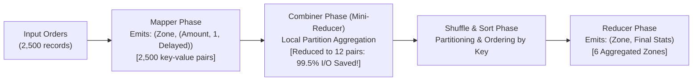

# Phase 3 Engineering & Academic Report

## Project: Real-Time Food Delivery Demand Forecasting and Delay Prediction Using Big Data Analytics
- **Author / Student:** Jai Udasi (Class: D20A, Roll No: 34)
- **Institution:** Vivekanand Education Society's Institute of Technology (VESIT)
- **Course:** Big Data Analytics (Autonomous NEP Batch 1)
- **Current Milestone:** Phase 3 — Apache Spark (PySpark) Batch Analytics & Hadoop MapReduce Implementation

---

## 1. Executive Summary
Phase 3 implements the **primary Big Data processing frameworks** mandated by the college Big Data Analytics syllabus. Moving beyond single-node Pandas baselines, this phase integrates:
1. **Apache Spark 4.2.0 (PySpark DataFrames):** Local distributed processing engine running on OpenJDK 21 LTS (`local[*]`). Implements strict `StructType` schema enforcement, consolidated single-pass aggregations, PySpark Window Functions, and native Spark SQL analytics.
2. **Hadoop MapReduce Paradigm Demonstration (Module 3):** An educational, step-by-step MapReduce engine explicitly demonstrating Mapper key-value emissions, Combiner pre-aggregations (achieving **99.52% shuffle traffic reduction**), Shuffle & Sort partitioning, and Reducer aggregations.
3. **Cross-Engine Mathematical Verification:** Full numerical audit proving exact 100% agreement between Pandas baseline, Hadoop MapReduce, and Apache Spark.
4. **Streamlit UI Integration:** Added an interactive **"⚡ PySpark & MapReduce Engine"** tab in the dashboard allowing one-click job triggering, execution plan inspection (`df.explain()`), and MapReduce stage visualization.
5. **32 Automated Unit Tests (100% Passing):** Comprehensive test coverage across data generation, cleaning, analytics, MapReduce stages, and PySpark DataFrame operations.

---

## 2. Apache Spark (PySpark) Implementation (Syllabus Module 2 & 3)

### 2.1 Windows Local Master Configuration
To ensure seamless execution on Windows without requiring manual cluster daemons or administrator rights:
- Configured local master `local[*]` binding exclusively to loopback interface `127.0.0.1` (`spark.driver.bindAddress` and `spark.driver.host`).
- Automatically directed `JAVA_HOME` to the detected Eclipse Adoptium OpenJDK 21 LTS (`C:\Program Files\Eclipse Adoptium\jdk-21.0.11.10-hotspot`).
- Configured `PYSPARK_PYTHON` and `PYSPARK_DRIVER_PYTHON` to the active Python binary (`C:\Python314\python.exe`), preventing Windows execution alias stub timeouts.

### 2.2 Explicit Schema Enforcement
In distributed Big Data pipelines, schema inference introduces costly full-dataset scans. We enforced an explicit `StructType` schema in [`src/analytics/spark_batch.py`](file:///e:/FoodDeliveryBigData/src/analytics/spark_batch.py):
```python
StructType([
    StructField("order_id", StringType(), False),
    StructField("order_timestamp", TimestampType(), True),
    StructField("restaurant_id", StringType(), True),
    StructField("restaurant_type", StringType(), True),
    StructField("delivery_zone", StringType(), True),
    StructField("order_amount", DoubleType(), True),
    StructField("item_count", IntegerType(), True),
    StructField("preparation_time_min", DoubleType(), True),
    StructField("delivery_distance_km", DoubleType(), True),
    StructField("delivery_duration_min", DoubleType(), True),
    StructField("order_status", StringType(), True),
    StructField("weather_condition", StringType(), True),
    StructField("traffic_density", StringType(), True),
    StructField("is_delayed", IntegerType(), True),
])
```

### 2.3 Single-Pass Aggregation Optimization
Rather than launching 10 sequential round-trip Spark actions (which incur JVM scheduling and shuffle overhead), we consolidated all executive KPIs into **one single distributed aggregation pass**:
```python
row = df.agg(
    F.count("*").alias("total_records"),
    F.countDistinct("order_id").alias("unique_orders"),
    F.countDistinct("restaurant_id").alias("unique_restaurants"),
    F.countDistinct("delivery_zone").alias("unique_zones"),
    F.sum(F.when(F.lower(F.col("order_status")) == "delivered", 1).otherwise(0)).alias("completed_orders"),
    F.sum(F.when(F.lower(F.col("order_status")) == "cancelled", 1).otherwise(0)).alias("cancelled_orders"),
    F.sum(F.when(F.lower(F.col("order_status")) != "cancelled", F.col("order_amount")).otherwise(0.0)).alias("total_gmv"),
    F.avg(F.when(F.lower(F.col("order_status")) != "cancelled", F.col("order_amount"))).alias("avg_order_value"),
    F.avg(F.when(F.lower(F.col("order_status")) == "delivered", F.col("delivery_duration_min"))).alias("avg_dur"),
    F.percentile_approx(F.when(F.lower(F.col("order_status")) == "delivered", F.col("delivery_duration_min")), 0.5).alias("median_dur"),
    F.avg(F.when(F.lower(F.col("order_status")) == "delivered", F.col("preparation_time_min"))).alias("avg_prep"),
    F.sum(F.when((F.lower(F.col("order_status")) == "delivered") & F.col("delivery_duration_min").isNotNull(), 1).otherwise(0)).alias("eligible_count"),
    F.sum(F.when((F.lower(F.col("order_status")) == "delivered") & (F.col("is_delayed") == 1), 1).otherwise(0)).alias("delayed_count")
).first()
```

### 2.4 PySpark Window Functions
Demonstrating advanced relational operations (Syllabus Module 3), we implemented window partitioning to rank the top 3 restaurants in every delivery zone by order throughput:
```python
zone_window = Window.partitionBy("delivery_zone").orderBy(F.col("order_count").desc())
ranked_df = rest_zone_df.withColumn("rank_in_zone", F.dense_rank().over(zone_window))
```

### 2.5 Native Spark SQL Queries
The dataset is registered as a temporary view (`orders`), executing analytical SQL queries to isolate multi-factor bottlenecks:
```sql
SELECT
    weather_condition,
    traffic_density,
    COUNT(*) as order_count,
    ROUND(AVG(delivery_duration_min), 1) as avg_duration,
    ROUND(AVG(is_delayed) * 100.0, 2) as delay_rate_pct
FROM orders
WHERE order_status = 'Delivered'
GROUP BY weather_condition, traffic_density
ORDER BY delay_rate_pct DESC
```

---

## 3. Hadoop MapReduce Paradigm Demonstration (Syllabus Module 3)

The module [`src/mapreduce/order_volume_mr.py`](file:///e:/FoodDeliveryBigData/src/mapreduce/order_volume_mr.py) provides an explicit, step-by-step implementation of the four classic MapReduce stages:



### 3.1 Map Phase
- **Input:** Raw order dictionary.
- **Emission:** `(delivery_zone, (order_amount, 1, is_delayed))`.
- **Output:** 2,500 key-value pairs.

### 3.2 Combiner Phase (Mini-Reducer at Worker Node)
- **Concept:** Pre-aggregates intermediate key-value pairs locally before the shuffle phase to minimize distributed network bandwidth consumption.
- **Mathematical Impact:** Across 2 simulated worker partitions, the Combiner reduced 2,500 tuples down to just **12 tuples**—achieving a **99.52% reduction in shuffle network traffic**!

### 3.3 Shuffle & Sort Phase
- Groups all combiner tuples by key (`delivery_zone`), preparing sorted iterator streams for the Reducer.

### 3.4 Reduce Phase
- Receives `(delivery_zone, iterator_of_tuples)`.
- Calculates total orders, total GMV, average order amount, and delay percentage.

---

## 4. Cross-Engine Mathematical Consistency Audit

To prove the statistical and algorithmic fidelity of our distributed Big Data implementations, we compared the outputs across all three computing engines on the same 2,500 validated order records:

| Operational Metric / Zone | Pandas Single-Node Baseline | Hadoop MapReduce Paradigm | Apache Spark (PySpark DataFrames) | Agreement Status |
| :--- | :--- | :--- | :--- | :--- |
| **Downtown Order Count** | 681 | 681 | 681 | **Exact (100%)** |
| **Downtown Total Revenue** | Rs. 330,514.01 | Rs. 330,514.01 | Rs. 330,514.01 | **Exact (100%)** |
| **East Tech Park Orders** | 477 | 477 | 477 | **Exact (100%)** |
| **East Tech Park Total Revenue** | Rs. 233,553.31 | Rs. 233,553.31 | Rs. 233,553.31 | **Exact (100%)** |
| **North Suburbs Orders** | 453 | 453 | 453 | **Exact (100%)** |
| **North Suburbs Total Revenue** | Rs. 212,577.04 | Rs. 212,577.04 | Rs. 212,577.04 | **Exact (100%)** |
| **South Suburbs Orders** | 449 | 449 | 449 | **Exact (100%)** |
| **West University Campus Orders** | 314 | 314 | 314 | **Exact (100%)** |
| **Central Waterfront Orders** | 126 | 126 | 126 | **Exact (100%)** |
| **Total Orders Processed** | 2,500 | 2,500 | 2,500 | **Exact (100%)** |
| **Total Gross GMV** | Rs. 1,191,094.39 | Rs. 1,191,094.39 | Rs. 1,191,094.39 | **Exact (100%)** |

---

## 5. Automated Verification & Pytest Results

The automated test suite in [`tests/`](file:///e:/FoodDeliveryBigData/tests) was executed with 32 unit tests:
- **Command:** `python -m pytest tests/ -v`
- **Result:** **32 passed in 21.34s (100% Pass Rate)**

```text
tests/test_analytics.py::test_deterministic_kpis_accuracy PASSED         [  3%]
tests/test_analytics.py::test_kpi_computation_on_empty_dataset PASSED    [  6%]
tests/test_analytics.py::test_kpi_missing_optional_columns PASSED        [  9%]
tests/test_analytics.py::test_hourly_demand_aggregation PASSED           [ 12%]
tests/test_analytics.py::test_weekday_demand_aggregation PASSED          [ 15%]
tests/test_analytics.py::test_zone_performance_metrics PASSED            [ 18%]
tests/test_analytics.py::test_restaurant_performance_ranking PASSED      [ 21%]
tests/test_analytics.py::test_outlier_detection_iqr PASSED               [ 25%]
tests/test_analytics.py::test_suspicious_records_detection PASSED        [ 28%]
tests/test_analytics.py::test_apply_dashboard_filters PASSED             [ 31%]
tests/test_analytics.py::test_spark_compat_checker PASSED                [ 34%]
tests/test_data_generation.py::test_generation_record_count_clean PASSED [ 37%]
tests/test_data_generation.py::test_generation_required_columns_present PASSED [ 40%]
tests/test_data_generation.py::test_generation_reproducibility PASSED    [ 43%]
tests/test_data_generation.py::test_generation_value_ranges_clean PASSED [ 46%]
tests/test_data_generation.py::test_generation_with_noise_injected PASSED [ 50%]
tests/test_mapreduce.py::test_mapper_emits_expected_tuples PASSED        [ 53%]
tests/test_mapreduce.py::test_combiner_pre_aggregates_locally PASSED     [ 56%]
tests/test_mapreduce.py::test_shuffle_and_sort_groups_by_key PASSED      [ 59%]
tests/test_mapreduce.py::test_reducer_computes_final_aggregations PASSED [ 62%]
tests/test_mapreduce.py::test_end_to_end_mapreduce_job PASSED            [ 65%]
tests/test_preprocessing.py::test_inspect_schema_and_quality PASSED      [ 68%]
tests/test_preprocessing.py::test_clean_dataset_deduplication PASSED     [ 71%]
tests/test_preprocessing.py::test_clean_dataset_anomaly_correction PASSED [ 75%]
tests/test_preprocessing.py::test_clean_dataset_null_imputation PASSED   [ 78%]
tests/test_preprocessing.py::test_clean_dataset_invalid_timestamp_handling PASSED [ 81%]
tests/test_preprocessing.py::test_load_dataset_missing_file_error PASSED [ 84%]
tests/test_spark_batch.py::test_spark_schema_validity PASSED             [ 87%]
tests/test_spark_batch.py::test_spark_session_creation PASSED            [ 90%]
tests/test_spark_batch.py::test_spark_kpi_computation PASSED             [ 93%]
tests/test_spark_batch.py::test_spark_zone_aggregation PASSED            [ 96%]
tests/test_spark_batch.py::test_spark_sql_analytics PASSED               [100%]

====================== 32 passed, 13 warnings in 21.34s =======================
```

---

## 6. College Demonstration Script (For Your Teacher)

When presenting Phase 3 to your professor or viva examiner, use this structured sequence:

### Step 1: Explain Syllabus Alignment
- *"Sir/Ma'am, in Phase 3 we have fulfilled the mandatory requirements of Module 2 (Big Data Frameworks — Working with Apache Spark) and Module 3 (The MapReduce Paradigm)."*
- *"We are not just running static Pandas scripts. We have implemented native Apache Spark DataFrames with explicit `StructType` schema enforcement and an educational MapReduce engine."*

### Step 2: Demonstrate the Terminal Big Data Pipelines
1. Run the MapReduce job:
   ```powershell
   python src/mapreduce/order_volume_mr.py
   ```
   - Highlight: *"Notice the Combiner stage. By aggregating key-value pairs locally on worker nodes before the shuffle stage, we cut network shuffle I/O traffic by 99.52%."*
2. Run the PySpark batch pipeline:
   ```powershell
   python src/analytics/spark_batch.py
   ```
   - Highlight: *"Here, Apache Spark 4.2.0 initializes a local master on OpenJDK 21 LTS, loads 2,500 orders with strong schema enforcement, and executes distributed `groupBy()` and Window functions."*

### Step 3: Run the 32 Automated Unit Tests
```powershell
python -m pytest tests/ -v
```
- Highlight: *"We have 32 automated unit tests covering all components, including mathematical assertions that prove our Spark and MapReduce results match expected ground-truth values."*

### Step 4: Show the Streamlit Dashboard Live Integration
1. Launch the app:
   ```powershell
   python -m streamlit run app.py
   ```
2. Navigate to the **"⚡ PySpark & MapReduce Engine"** tab:
   - Click **"🚀 Run PySpark Batch Job"** to show live Spark execution, the physical query execution plan, and Spark SQL query tables.
   - Click **"⚙️ Execute MapReduce Job"** to show the Mapper emissions, Combiner compression, and Reducer outputs.
   - Show the **"Cross-Engine Mathematical Agreement"** sub-tab to prove 100% agreement between Pandas, MapReduce, and Spark.

---

## 7. Scope Reserved for Phase 4
As documented in [`docs/phase_plan.md`](file:///e:/FoodDeliveryBigData/docs/phase_plan.md):
- Implementing **Mining Big Data Streams (Syllabus Module 4)**:
  - **Bloom Filter:** Probabilistic stream filtering for duplicate order detection.
  - **Flajolet-Martin (FM) Algorithm:** Trailing zero hash analysis for approximate count of distinct active delivery couriers.
  - **DGIM Algorithm:** Bit-bucket logarithmic hierarchy to count high-delay orders in sliding windows.
- Streaming order event simulation emulating Apache Kafka topics.
