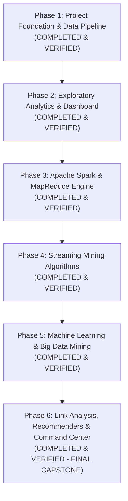

# Complete Project Roadmap & Phase Plan

## Project: Real-Time Food Delivery Demand Forecasting and Delay Prediction Using Big Data Analytics
**Student:** Jai Udasi (Class: D20A, Roll No: 34)  
**Academic Target:** Big Data Analytics Mini Project & Academic Demonstration  
**Current Milestone:** Phase 6 Complete (Full Project Capstone Verified: Link Analysis, Dual Recommenders, MongoDB Operational Store & Command Center)

---

## Roadmap Overview

---

## Phase Milestones & Status

### Phase 1: Project Foundation, Data Pipeline & Quality Audit *(Status: COMPLETED & VERIFIED)*
- **Delivered:** Modular Python project structure, reproducible synthetic order generator (seed=42), veracity cleaning pipeline (`clean_data.py`), automated JSON quality audit, and 11 unit tests.

---

### Phase 2: Exploratory Data Analytics & Interactive Dashboard *(Status: COMPLETED & VERIFIED - Current)*
- **Core Objectives:**
  1. Build an interactive Streamlit & Plotly operations dashboard answering core operational questions:
     - When is demand highest? (Hourly 24-cycle & weekday vs. weekend).
     - Which zones receive the highest volume? (Spatial demand share).
     - How does delivery duration vary? (Distributions, box plots, medians).
     - What proportion of eligible orders are delayed? (Documented SLA formula and denominator).
     - How does food preparation time relate to delivery duration? (Scatter plot with trendline).
     - What data quality issues exist? (Schema, missingness, duplicates, Tukey's IQR outliers, suspicious records).
  2. Implement multi-dimensional, combined sidebar filters (date range, day type, hour, zone, restaurant type, order status, weather, traffic) with clean handling of empty matching records.
  3. Prepare architectural contracts in `src/analytics/contracts.py` ensuring Phase 3 PySpark integration will require zero dashboard UI rewrites.
  4. Perform Windows PySpark readiness check in `src/analytics/spark_compat.py` (OpenJDK 21 LTS detected).
  5. Expand test suite to 22 passing tests covering deterministic mathematical formulas, filters, outlier detection, and edge cases.

---

### Phase 3: Apache Spark (PySpark) & MapReduce Implementation *(Status: COMPLETED & VERIFIED - Current)*
- **Mandatory Syllabus Technologies:** Apache Spark (PySpark) & MapReduce Paradigm.
- **Core Objectives:**
  1. **PySpark Installation & Windows Configuration:**
     - Configure `JAVA_HOME` pointing to detected OpenJDK 21 LTS (`C:\Program Files\Eclipse Adoptium\jdk-21.0.11.10-hotspot`).
     - Install `pyspark` and establish local master `SparkSession.builder.master("local[*]").appName("FoodDeliveryBigData").getOrCreate()`.
  2. **PySpark DataFrame Batch Processing Engine (`src/analytics/spark_batch.py`):**
     - Load dataset into native Spark DataFrame with explicit `StructType` schema.
     - Execute distributed transformations:
       - Filtering: `df.filter(...)`
       - Grouping & Aggregations: `df.groupBy("delivery_zone").agg(...)`
       - Window Functions: Rolling hourly velocity and ranking using `pyspark.sql.window.Window`.
       - Spark SQL: Execute analytical queries via temporary SQL views (`df.createOrReplaceTempView("orders")`).
  3. **Explicit MapReduce Algorithm Demonstration (`src/mapreduce/order_volume_mr.py`):**
     - Standalone demonstration of the Hadoop MapReduce paradigm (Module 3):
       - **Mapper:** Emits intermediate key-value pairs `(zone, (order_amount, 1))`.
       - **Shuffle & Sort:** Emulates key partitioning and sorting.
       - **Combiner:** Emulates local pre-aggregation to minimize network shuffle.
       - **Reducer:** Computes aggregated totals and averages.
       - Intermediate outputs printed clearly for college teacher demonstration.
  4. **Cross-Validation Test Suite:**
     - Pytest suite (`tests/test_spark_processing.py`) running PySpark on deterministic fixtures, proving Spark DataFrame outputs agree with expected ground-truth calculations.
  5. **Dashboard Connection:**
     - Connect Streamlit to display PySpark execution plans (`df.explain()`), job partition counts, and curated metrics.

---

### Phase 4: Big Data Streaming Algorithms & Stream Ingestion *(Status: COMPLETED & VERIFIED - Current)*
- **Syllabus Module 4 (Mining Data Streams):**
  1. **Order Stream Simulator (`src/streaming/order_stream_simulator.py`):** High-throughput generator emulating Apache Kafka topics with dynamic rush surges, queue transport, and duplicate injection.
  2. **Bloom Filter (`src/streaming/bloom_filter.py`):** Bit array with $k$ independent hash functions for duplicate order suppression in $O(k)$ time with zero false negatives and empirical false positive benchmark.
  3. **Flajolet-Martin Algorithm (`src/streaming/flajolet_martin.py`):** Distinct active courier count estimation using trailing zeros bit analysis and median-of-means variance reduction.
  4. **DGIM Algorithm (`src/streaming/dgim_window.py`):** Sliding-window power-of-2 bucket hierarchy to count delayed orders in the last $N$ stream events in $O(\log^2 N)$ memory with error strictly bounded $\le 50\%$.
  5. **14 Unit Tests:** Verified in `tests/test_streaming_algorithms.py` (total test suite: 46 passing tests).
  6. **Dashboard Integration:** Integrated into Streamlit under "4. Mining Big Data Streams" with live interactive simulation and telemetry.

---

### Phase 5: Machine Learning & Big Data Mining Algorithms *(Status: COMPLETED & VERIFIED - Current)*
- **Syllabus Module 5 (Big Data Mining Algorithms):**
  1. **Frequent Itemset Mining (PCY Algorithm) (`src/mining/pcy_market_basket.py`):**
     - Authentic two-pass Park-Chen-Yu algorithm with pair hashing into a fixed-size integer bucket array $H$ of size $B$.
     - Bit array construction reducing memory footprint during Pass 1.
     - Candidate pair filtering in Pass 2: only pairs $\{i, j\}$ where both $i, j \in L_1$ and $H[\{i, j\}]$ is frequent are counted.
     - Association rule generation reporting Support, Confidence, and Lift ($Lift > 1$ denotes positive complementarity).
     - Verified with hand-checkable fixture and exact itemset counting.
  2. **Spatial Delivery-Hub Clustering (`src/mining/spatial_clustering.py`):**
     - Spatial K-Means clusterer using great-circle Haversine distance metric (km) across Mumbai delivery coordinates.
     - Hyperparameter range search over $k \in [3, 8]$ evaluating Inertia and Silhouette scores to determine optimal courier staging hubs.
     - Hub coordinate summary and cluster assignment outputs.
  3. **Supervised Delivery Delay-Risk Classifier (`src/ml/delay_prediction.py`):**
     - Binary classification of order SLA breaches (`is_delayed`) using pre-delivery features (`delivery_distance_km`, `preparation_time_min`, `item_count`, `order_hour`, `weather_condition`, `traffic_density`, `delivery_zone`).
     - **Strict Zero Data Leakage Guarantee:** Strictly excluded post-delivery attributes (`delivery_duration_min`, `order_status`). Preprocessing (StandardScaler, OneHotEncoder) fit exclusively on the training split.
     - Comparative benchmarking: Logistic Regression vs. Random Forest Classifier.
     - Metrics reported: Accuracy, Precision, Recall, F1-Score, ROC-AUC, Confusion Matrix, and Feature Importances.
     - Saved production pipeline in `data/processed/models/delay_classifier.joblib` with single-order inference function.
  4. **Time-Series Demand Forecasting (`src/ml/demand_forecasting.py`):**
     - Continuous hourly demand time-series builder filling zero-order hours with 0 counts.
     - Strict chronological 80/20 train/test evaluation (forward in time) preventing future lookahead leakage.
     - Feature engineering: `lag_1h`, `lag_2h`, `lag_3h`, `lag_24h`, `rolling_mean_3h`, `hour_of_day`, `is_weekend`.
     - Ridge regression with non-negativity constraint benchmarked against a Naive Persistence Baseline (`lag_1h`), reporting MAE and RMSE.
     - Multi-step recursive forecasting for upcoming 1h, 3h, and 24h horizons per delivery zone.
  5. **18 Unit Tests Added:** Verified in `tests/test_pcy_market_basket.py` (6), `tests/test_spatial_clustering.py` (4), `tests/test_delay_prediction.py` (4), and `tests/test_demand_forecasting.py` (4) — bringing the total project test suite to **64 passing tests**.
  6. **Interactive Dashboard UI:** Tab 5 of the Streamlit dashboard enriched with 4 functional subtabs: PCY Market Basket, Spatial Hubs, Delay Risk Predictor, and Time-Series Demand Forecasting.

---

### Phase 6: Link Analysis, Social Network Graphs, Recommendation Engines & Command Center *(Status: COMPLETED & VERIFIED - Final Capstone)*
- **Syllabus Module 6 (Link Analysis & Recommendation Systems) & Module 2 (NoSQL):**
  1. **Bipartite Customer-Restaurant Graph Centrality (`src/mining/link_analysis_recommender.py`):**
     - Customer-restaurant bipartite interaction graph modeled as adjacency matrix $A$.
     - PageRank algorithm ($d = 0.85$, power iteration) ensuring total network probability sum = 1.0, identifying anchor restaurants.
     - Kleinberg's HITS algorithm computing mutual reinforcement between authority restaurants and hub customers.
  2. **Dual Recommendation Engines (`src/mining/link_analysis_recommender.py`):**
     - Content-Based Filtering: Cosine similarity on restaurant feature profiles (cuisine, prep time, price, delivery speed).
     - Collaborative Filtering: User-Item interaction matrix similarity predicting unvisited restaurants based on peer order habits.
     - Cold-start fallback handling for unseen customers.
  3. **MongoDB Operational Persistence Store (`src/nosql/mongo_manager.py`):**
     - Three logical collections: `active_orders` (in-flight state), `courier_telemetry` (GeoJSON coordinates with 2dsphere indexing), and `zone_risk_scores`.
     - Idempotent upserts, index management, environment variable configuration (`MONGODB_URI`, `MONGODB_DB_NAME`).
     - Transparent local SQLite fallback store ensuring zero crash during offline demonstrations.
  4. **Unified Operations Command Center (`app.py` & `src/dashboard/overview.py`):**
     - Section A: Live Event Stream (wire-speed Kafka simulator, Bloom Filter, Flajolet-Martin, DGIM).
     - Section B: Spatial Demand Overview, multi-horizon forecasts, and courier staging map.
     - Section C: Proactive Delay-Risk Alerting with configurable threshold slider (default: 75%).
     - Section D: Recommendation Showcase (PCY frequent combos + personalized cuisine matches).
     - Section E: System Health diagnostic grid across all 6 architectural tiers.
  5. **13 Unit Tests Added:** Verified in `tests/test_mongo_manager.py` (7) and `tests/test_link_analysis_recommender.py` (6) — bringing the total project test suite to **77 passing tests (100% pass rate in ~33s)**.
  6. **Interactive Presentation & Defense Package:** Self-contained HTML presentation deck in `presentation/bda_project_slides.html` and 45+ viva Q&As in `docs/viva_questions_and_answers.md`.
