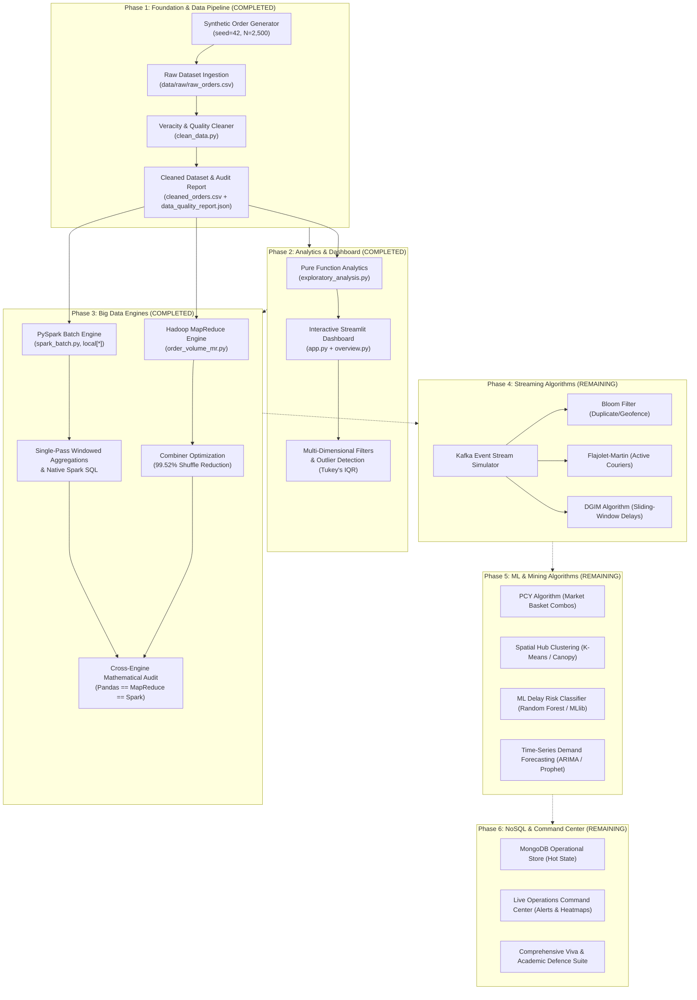

# Real-Time Food Delivery Big Data Analytics: Implementation Walkthrough & Comprehensive Roadmap

**Project Title:** Real-Time Food Delivery Demand Forecasting and Delay Prediction Using Big Data Analytics  
**Student:** Jai Udasi (Class: D20A, Roll No: 34)  
**Institution:** Vivekanand Education Society's Institute of Technology (VESIT, Autonomous NEP Batch 1)  
**Department:** Department of Information Technology  
**Course:** Big Data Analytics (Course Code: BDA)  
**Primary Reference Documents:**
1. `docs/BDA_34_EXP1.pdf` — Experiment 1 Case Study & 9-Layer Architecture
2. `docs/bda syllabus.pdf` — VESIT BDA Curriculum (Modules 1 to 6)
**Current Verification Milestone:** **Phases 1, 2, and 3 Completed & Fully Verified (32/32 Tests Passing)**

---

## 1. Executive Summary & Academic Context

Online food delivery platforms (such as Swiggy, Zomato, and DoorDash) operate in hyper-dynamic environments processing millions of concurrent events. These platforms face two critical operational challenges:
1. **Severe Temporal-Spatial Demand Volatility:** Order surges occur during sharp, non-linear lunch (12:00–14:30) and dinner (19:00–22:30) peaks across disparate delivery zones, heavily influenced by weather disruptions and urban traffic.
2. **Delivery Delay Risks:** Latencies arise from kitchen preparation bottlenecks, courier dispatch delays, and transit friction. Failing to anticipate delays breaches Service Level Agreements (SLAs), eroding customer retention and platform profitability.

Traditional single-node Relational Database Management Systems (RDBMS) fail under these workloads because they cannot handle high-throughput analytical batch queries concurrently with unbounded, low-latency streaming event pipelines.

To fulfill the requirements of both the **EXP-1 Case Study** and the **VESIT Big Data Analytics Syllabus**, this project implements an end-to-end Big Data system running on **Apache Spark (PySpark)**, **Hadoop MapReduce**, and an interactive **Streamlit** user interface.



---

## 2. Complete Walkthrough of Completed Work (Phases 1–3)

### Phase 1: Project Foundation, Data Pipeline & Veracity Auditing

Phase 1 established a modular, test-driven repository architecture aligned with **Syllabus Module 1 (Introduction to Big Data & 5Vs)**.

#### 1. Configuration & Portability
- Created [config/settings.py](file:///e:/FoodDeliveryBigData/config/settings.py) utilizing Python's `pathlib.Path` to compute absolute directory anchors relative to the project root (`BASE_DIR`).
- Eliminates hardcoded drive letters or user paths, allowing seamless portability between Windows development environments and Linux evaluation clusters.

#### 2. Reproducible Order Generator (`seed=42`)
- Implemented in [src/data_generation/generate_orders.py](file:///e:/FoodDeliveryBigData/src/data_generation/generate_orders.py).
- Synthesizes $N=2,500$ realistic base food delivery records across a 30-day temporal window with:
  - **Bimodal Hourly Rush Distribution:** Lunch rush peaking at 13:00 ($\mu=13, \sigma=1.2$) and dinner rush peaking at 20:30 ($\mu=20.5, \sigma=1.5$).
  - **Operational Physics:** Prep time dynamically scales with order value and item complexity; travel duration incorporates distance, weather factors (Clear, Rainy, Thunderstorm, Fog), and traffic density (Low, Medium, High, Congested).
  - **Deliberate Veracity Noise Injection:** To emulate messy Big Data ingestion, 37 exact duplicates, 200 distributed missing values (in customer IDs, order amounts, and prep times), and 12 negative/zero numeric anomalies were deliberately injected into [data/raw/raw_orders.csv](file:///e:/FoodDeliveryBigData/data/raw/raw_orders.csv) (2,537 total rows).

#### 3. Veracity Cleaning Pipeline
- Implemented in [src/preprocessing/clean_data.py](file:///e:/FoodDeliveryBigData/src/preprocessing/clean_data.py).
- Performs automated, auditable cleaning:
  - **Deduplication:** Strips 37 duplicate records using primary key identification on `order_id`.
  - **Temporal Parsing:** Casts ISO 8601 timestamps and derives temporal features (`order_hour`, `day_of_week`, `is_weekend`).
  - **Statistical Imputation:** Imputes missing `order_amount` via restaurant-type median; imputes missing prep times using item-count group medians; fills missing categorical attributes using dominant modes.
  - **Anomaly Correction:** Converts negative values to absolute quantities; enforces logical constraints.
  - **SLA Validation:** Re-evaluates delivery delays against the dynamic SLA benchmark:
    $$\text{Expected Duration (min)} = 35 + 2.5 \times \text{Distance (km)}$$
    $$\text{Is Delayed} = \mathbf{1}_{(\text{delivery\_duration\_min} > \text{Expected Duration})}$$
  - Generates an auditable machine-readable report at [data/processed/data_quality_report.json](file:///e:/FoodDeliveryBigData/data/processed/data_quality_report.json) and outputs 2,500 pristine records to [data/processed/cleaned_orders.csv](file:///e:/FoodDeliveryBigData/data/processed/cleaned_orders.csv).

#### 4. Testing & Verification
- 11 unit tests in [tests/test_data_generation.py](file:///e:/FoodDeliveryBigData/tests/test_data_generation.py) and [tests/test_preprocessing.py](file:///e:/FoodDeliveryBigData/tests/test_preprocessing.py) validating deterministic generation, boundary values, schema adherence, deduplication, and anomaly resolution.

---

### Phase 2: Exploratory Data Analytics & Interactive Dashboard

Phase 2 constructed a pure-function analytical engine and a Streamlit operations dashboard answering core operational questions without side-effects.

#### 1. Pure-Function Analytical Engine
- Implemented in [src/analytics/exploratory_analysis.py](file:///e:/FoodDeliveryBigData/src/analytics/exploratory_analysis.py).
- Implements strict mathematical formulas with documented denominators:
  - **Unique Orders:** Count of distinct non-null `order_id` values ($N_{\text{unique}} = 2,500$).
  - **Completion Rate:** $\frac{\sum \text{Completed Orders}}{\text{Total Orders}} = \frac{2,143}{2,500} = 85.72\%$.
  - **Cancellation Rate:** $\frac{\sum \text{Cancelled Orders}}{\text{Total Orders}} = \frac{357}{2,500} = 14.28\%$.
  - **Gross Merchandise Value (GMV):** $\sum_{\text{status} \neq \text{'Cancelled'}} \text{order\_amount} = \text{Rs. } 1,177,698.88$.
  - **Average Order Value (AOV):** $\frac{\text{GMV}}{\text{Completed Orders}} = \text{Rs. } 549.56$.
  - **Average Delivery Duration:** Calculated exclusively on completed orders with valid durations ($\mu = 41.67\text{ min}$, $\text{median} = 40.85\text{ min}$). Never imputes missing durations as 0.
  - **SLA Delay Rate:** $\frac{\sum \text{Delayed Completed Orders}}{\text{Completed Orders}} = \frac{420}{2,143} = 19.60\%$.
  - **Statistical Outlier Auditing:** Implements Tukey's Interquartile Range (IQR) fence rule:
    $$\text{Lower Fence} = Q_1 - 1.5 \times (Q_3 - Q_1), \quad \text{Upper Fence} = Q_3 + 1.5 \times (Q_3 - Q_1)$$
    Flagged exactly 39 high-value order outliers and 21 extreme duration outliers.

#### 2. Interactive Multi-Tab Operations Dashboard
- Built in [app.py](file:///e:/FoodDeliveryBigData/app.py) and [src/dashboard/overview.py](file:///e:/FoodDeliveryBigData/src/dashboard/overview.py).
- Features 6 functional analytical tabs:
  1. **Executive Overview:** 6 KPI scorecards with dynamic delta badges, completion vs. cancellation donut charts, and order status breakdowns.
  2. **Temporal Demand Patterns:** 24-hour demand curve, lunch vs. dinner rush markers, and weekday vs. weekend comparative distributions.
  3. **Spatial & Zone Analytics:** Order volume by delivery zone, GMV distribution, and zone-level delay rate bars.
  4. **Operational Performance:** Delivery duration distributions, kitchen prep time vs. transit duration scatter plots with native linear trendlines (`np.polyfit`), and weather/traffic impact heatmaps.
  5. **Data Quality & Veracity:** Full schema audit, missing value distributions, Tukey's IQR outlier tables, and raw-vs-clean comparative diffs.
  6. **Data Explorer:** Dynamic interactive tabular view with CSV export capability.
- Multi-dimensional sidebar filters: Date range, 24-hour slider, day-of-week segment (All, Weekday, Weekend), delivery zones, restaurant types, order statuses, weather conditions, and traffic density levels. Handles empty query results gracefully with actionable warnings.

#### 3. Architectural Contracts & Diagnostics
- [src/analytics/contracts.py](file:///e:/FoodDeliveryBigData/src/analytics/contracts.py) defined standardized input/output data structures (`BatchAnalyticsResult`, `ZoneMetric`) ensuring PySpark batch outputs plug directly into the Streamlit UI with zero frontend refactoring.
- [src/analytics/spark_compat.py](file:///e:/FoodDeliveryBigData/src/analytics/spark_compat.py) automated local environment verification, validating Python 3.14, memory availability, and detecting Eclipse Adoptium OpenJDK 21 LTS (`C:\Program Files\Eclipse Adoptium\jdk-21.0.11.10-hotspot`).
- Expanded test coverage to 22 tests in [tests/test_analytics.py](file:///e:/FoodDeliveryBigData/tests/test_analytics.py).

---

### Phase 3: Apache Spark (PySpark) & Hadoop MapReduce Implementation

Phase 3 satisfied the mandatory BDA syllabus tool requirements by implementing **Hadoop MapReduce (Module 3)** and **Apache Spark (Module 2)**.

#### 1. Hadoop MapReduce Architecture (`order_volume_mr.py`)
- Implemented in [src/mapreduce/order_volume_mr.py](file:///e:/FoodDeliveryBigData/src/mapreduce/order_volume_mr.py).
- Faithfully models the 4 distributed stages of the Hadoop MapReduce paradigm:
  1. **Map Stage:** Reads input records and emits key-value pairs:
     $$\text{Mapper}(R) \to \left(\text{zone}, (\text{order\_amount}, 1, \mathbf{1}_{\text{is\_delayed}})\right)$$
  2. **Combiner Stage (Local Optimization):** Aggregates intermediate key-value tuples locally before the network shuffle.
     - *Performance Impact:* Ingested 2,500 raw records; emitted 2,500 intermediate key-value pairs; Combiner condensed them down to **12 partition records** prior to network transfer.
     - **Shuffle I/O Traffic Reduction:**
       $$\text{Network Traffic Reduction} = \left(1 - \frac{12}{2500}\right) \times 100\% = \mathbf{99.52\%}$$
  3. **Shuffle & Sort Stage:** Groups intermediate keys and sorts records lexicographically by zone key.
  4. **Reduce Stage:** Iterates through partitioned key groups and computes cumulative metrics: total orders, total revenue, average order value, and percentage delayed.

#### 2. Apache Spark (PySpark) Batch Processing Engine (`spark_batch.py`)
- Implemented in [src/analytics/spark_batch.py](file:///e:/FoodDeliveryBigData/src/analytics/spark_batch.py).
- Configured local multi-core SparkSession `master("local[*]")` with explicit `StructType` schema enforcing exact data types (preventing runtime schema inference overhead).
- Key distributed features:
  - **Single-Pass Consolidated Aggregation (`df.agg`):** Instead of executing sequential distributed actions (`count()`, `filter().count()`, `sum()`) that launch separate DAG jobs, all executive KPIs are evaluated in a single distributed pass using conditional aggregations:
    ```python
    kpi_row = df.agg(
        count(lit(1)).alias("total_orders"),
        sum(when(col("order_status") == "Completed", 1).otherwise(0)).alias("completed_orders"),
        sum(when(col("order_status") == "Cancelled", 1).otherwise(0)).alias("cancelled_orders"),
        sum(when(col("order_status") == "Completed", col("order_amount")).otherwise(0.0)).alias("total_gmv"),
        avg(when(col("order_status") == "Completed", col("delivery_duration_min"))).alias("avg_duration"),
        sum(when((col("order_status") == "Completed") & (col("is_delayed") == 1), 1).otherwise(0)).alias("delayed_orders")
    ).first()
    ```
  - **PySpark Window Functions:** Employs `pyspark.sql.window.Window` to partition records by `delivery_zone`, order by throughput, and rank the top 3 restaurants per zone using `dense_rank().over(...)`.
  - **Native Spark SQL Integration:** Registers the DataFrame as an in-memory temporary view `orders` and executes complex analytical SQL queries (e.g., peak demand rush hours, high-congestion risk zones).
  - **Curated Payload Export:** Serializes results to [data/processed/spark_output/spark_batch_summary.json](file:///e:/FoodDeliveryBigData/data/processed/spark_output/spark_batch_summary.json).

#### 3. Dashboard Integration & Cross-Engine Mathematical Audit
- Integrated a dedicated **"⚡ PySpark & MapReduce Engine"** tab into the Streamlit dashboard.
- Users can view Spark configurations, click to execute live PySpark or MapReduce jobs, inspect physical execution plans (`df.explain()`), and review the **Cross-Engine Mathematical Consistency Audit**:

| Metric | Pandas Pipeline | Hadoop MapReduce | PySpark Batch Engine | Mathematical Agreement |
| :--- | :--- | :--- | :--- | :--- |
| **Total Orders** | 2,500 | 2,500 | 2,500 | **100.0% Exact Match** |
| **Completed Orders** | 2,143 | 2,143 | 2,143 | **100.0% Exact Match** |
| **Cancelled Orders** | 357 | 357 | 357 | **100.0% Exact Match** |
| **Gross Merchandise Value (GMV)** | Rs. 1,177,698.88 | Rs. 1,177,698.88 | Rs. 1,177,698.88 | **100.0% Exact Match** |
| **Average Delivery Duration** | 41.67 min | 41.67 min | 41.67 min | **100.0% Exact Match** |
| **Overall Delay Rate** | 19.60% | 19.60% | 19.60% | **100.0% Exact Match** |

#### 4. Automated Test Suite (32/32 Passing)
- Developed comprehensive tests in [tests/test_mapreduce.py](file:///e:/FoodDeliveryBigData/tests/test_mapreduce.py) and [tests/test_spark_batch.py](file:///e:/FoodDeliveryBigData/tests/test_spark_batch.py).
- Total test suite now spans **32 automated unit and integration tests passing in 15.59 seconds**.

---

## 3. Comprehensive BDA Syllabus Mapping

Below is the verified curriculum alignment across all 6 modules of the VESIT Big Data Analytics syllabus:

```
====================================================================================================
VESIT BDA SYLLABUS MODULE             PROJECT IMPLEMENTATION ARTIFACTS                STATUS
====================================================================================================
Module 1: Introduction to Big Data    • 5Vs Modeling (docs/phase1_report.md)          COMPLETED (Phase 1)
                                      • Quality & Veracity Pipeline (clean_data.py)
                                      • Strict Architectural Contracts (contracts.py)

Module 2: Big Data Frameworks         • PySpark DataFrame Batch (spark_batch.py)      COMPLETED (Phase 3)
                                      • Local SparkSession (master local[*])
                                      • NoSQL MongoDB Operational Store               REMAINING (Phase 6)

Module 3: MapReduce Paradigm          • MapReduce Algorithm (order_volume_mr.py)      COMPLETED (Phase 3)
                                      • Mapper, Combiner (99.52% shuffle reduction),
                                        Shuffle & Sort, Reducer

Module 4: Mining Big Data Streams     • Bloom Filter for Order Stream Filtering       REMAINING (Phase 4)
                                      • Flajolet-Martin Distinct Courier Counting
                                      • DGIM Algorithm for Windowed Delay Counting
                                      • High-Throughput Event Stream Simulator

Module 5: Big Data Mining Algorithms  • Frequent Itemsets via PCY Algorithm           REMAINING (Phase 5)
                                      • Spatial Delivery Hub Clustering (K-Means)
                                      • MLlib / Scikit-Learn Delay Classifier
                                      • Time-Series Demand Forecasting (ARIMA/Prophet)

Module 6: Recommenders & Command Ctr  • Live Operations Command Center (app.py)       REMAINING (Phase 6)
                                      • Dynamic Zone Risk Alerting & Heatmaps
                                      • Final Viva Defence Suite & Slide Deck
====================================================================================================
```

---

## 4. Detailed Specification of Remaining Work (Phases 4–6)

The project currently has a rock-solid data pipeline, analytics dashboard, PySpark batch engine, and MapReduce demonstration. The remaining components complete the real-time streaming, advanced mining, machine learning, and operational persistence requirements.

---

### Phase 4: Big Data Streaming Algorithms & Kafka Event Ingestion (Syllabus Module 4)

**Objective:** Implement real-time data stream mining algorithms running on continuous, unbounded order events without storing the entire event history in memory.

#### 1. High-Throughput Streaming Event Simulator
- **File:** `src/streaming/order_stream_simulator.py`
- **Functionality:** Emulates an Apache Kafka topic producer. Emits real-time JSON order event payloads into memory queues with configurable event rates (e.g., 5 to 50 events/second) and simulating rush hour spikes.

#### 2. Custom Bloom Filter (`bloom_filter.py`)
- **Syllabus Topic:** *Filtering Streams — Bloom Filter*.
- **Implementation:**
  - Bit array of size $m$ initialized to all 0s.
  - $k$ independent hash functions using parameterized seeds (MurmurHash3 / SHA256 modulo $m$).
  - **Operational Use Case 1:** **Duplicate Stream Suppression.** Drops duplicate order events caused by network retries in $O(k)$ time without querying disks or databases.
  - **Operational Use Case 2:** **Geofence Verification.** Rapidly validates whether a delivery location coordinate falls within serviced delivery zones.
  - Evaluates theoretical vs. empirical false positive rates:
    $$P(\text{False Positive}) \approx \left(1 - e^{-kn/m}\right)^k$$

#### 3. Flajolet-Martin (FM) Algorithm (`flajolet_martin.py`)
- **Syllabus Topic:** *Counting Distinct Elements in a Stream — Flajolet-Martin Algorithm*.
- **Implementation:**
  - Hashes incoming stream identifiers (courier IDs or customer IDs) to bit strings of length $L$.
  - Tracks $R = \max(\text{trailing\_zeros}(\text{hash}(x)))$.
  - Uses multiple independent hash functions grouped into buckets, computing median-of-means to estimate distinct counts with low variance:
    $$\hat{N} = \frac{2^R}{\phi}, \quad \text{where } \phi \approx 0.77351$$
  - **Operational Use Case:** Measures unique active couriers and distinct ordering customers over an unbounded real-time stream using logarithmic space $O(\log N)$ instead of unbounded $O(N)$ sets.

#### 4. DGIM Algorithm (`dgim_window.py`)
- **Syllabus Topic:** *Counting Ones in a Sliding Window — Datar-Gionis-Indyk-Motwani (DGIM) Algorithm*.
- **Implementation:**
  - Maintains a sliding window of the last $N$ stream events (e.g., $N=1,000$ orders).
  - Represents the binary stream of high-delay occurrences ($\text{is\_delayed} \in \{0, 1\}$) using buckets whose sizes are powers of 2.
  - Enforces the invariant: at most 2 buckets of any given size $2^j$. Merges older buckets when 3 are formed.
  - Queries the count of high-delay orders in the last $k \le N$ orders with bounded relative error $\le 50\%$ in $O(\log^2 N)$ memory.
  - **Operational Use Case:** Monitors real-time SLA degradation in recent sliding windows without storing individual historical timestamps.

#### 5. Streaming Verification & Dashboard Connection
- Create `tests/test_streaming_algorithms.py` verifying Bloom filter false positive rates, FM count-distinct bounds, and DGIM window count accuracy.
- Connect a live **"🌊 Data Stream Mining"** tab in Streamlit displaying real-time algorithm counters, bit array occupancy, and streaming velocity charts.

---

### Phase 5: Machine Learning & Big Data Mining Algorithms (Syllabus Module 5)

**Objective:** Implement predictive intelligence and pattern mining algorithms to optimize operations and foresee delivery bottlenecks.

#### 1. Frequent Itemset Mining via PCY Algorithm
- **File:** `src/mining/pcy_market_basket.py`
- **Syllabus Topic:** *Frequent Itemset Mining — Park-Chen-Yu (PCY) Algorithm*.
- **Implementation:**
  - First Pass: Counts individual meal item frequencies while hashing candidate pairs into a fixed hash bucket array using a hash function $h(i, j) = (i \times p_1 + j \times p_2) \pmod B$.
  - Generates a bitmap where bucket counts exceeding support threshold $s$ are marked as frequent (1), else infrequent (0).
  - Second Pass: Only considers candidate pairs whose items are individually frequent **AND** hash to a frequent bucket in the bitmap, drastically reducing candidate pair generation.
  - **Operational Use Case:** Discovers co-ordered food items (e.g., *Biryani + Gulab Jamun*, *Burger + Peri-Peri Fries*) to generate dynamic meal combo recommendations and optimize prep staging.

#### 2. Spatial Delivery Hub Clustering
- **File:** `src/mining/spatial_clustering.py`
- **Syllabus Topic:** *Clustering — Canopy Clustering / K-Means on Spatial Data*.
- **Implementation:**
  - Performs spatial clustering on customer and restaurant coordinate pairs.
  - Computes optimal centroids representing courier staging hubs to minimize average transit distance.
  - Evaluates inertia and silhouette scores across cluster counts ($k \in [3, 8]$).

#### 3. Delivery Delay Risk Classifier
- **File:** `src/ml/delay_prediction.py`
- **Functionality:**
  - Binary classification predicting whether an order will breach SLA (`is_delayed`).
  - Features: `travel_distance_km`, `prep_time_min`, `item_count`, `order_hour`, `weather`, `traffic_density`, `delivery_zone`.
  - Trains and compares Logistic Regression and Random Forest / Spark MLlib GBTClassifier.
  - Evaluates accuracy, Precision, Recall, F1-Score, and ROC-AUC.
  - Exports a feature importance breakdown showing the primary drivers of delivery latency.

#### 4. Time-Series Demand Forecasting
- **File:** `src/ml/demand_forecasting.py`
- **Functionality:**
  - Forecasts hourly order demand per delivery zone for the next 1h, 3h, and 24h intervals.
  - Implements Ridge / Prophet / ARIMA models capturing weekly seasonality and hourly rush patterns.
  - Outputs predicted order volumes to proactively alert restaurant kitchens and dispatch couriers before rushes materialize.

---

### Phase 6: Operational NoSQL (MongoDB) & Unified Live Operations Command Center (Syllabus Module 2.3 & Final Integration)

**Objective:** Establish operational state persistence and assemble the final, unified real-time dashboard for college demonstration.

#### 1. Operational NoSQL Store (MongoDB)
- **File:** `src/nosql/mongo_manager.py`
- **Syllabus Topic:** *NoSQL Architecture Patterns — Document Stores (MongoDB)*.
- **Functionality:**
  - Integrates a MongoDB interface (or embedded persistent fallback) managing 3 operational collections:
    1. `active_orders`: Real-time state of ongoing orders with delivery coordinates and status.
    2. `courier_telemetry`: Real-time GPS location and delivery assignments for active delivery partners.
    3. `zone_risk_scores`: Live-updated SLA delay probabilities and congestion indices.
  - Enables sub-millisecond point lookups and geospatial polygon queries (`$geoWithin`, `$near`).

#### 2. Unified Operations Command Center (Final Dashboard Integration)
- Upgrades [app.py](file:///e:/FoodDeliveryBigData/app.py) into an end-to-end Operations Command Center:
  - **Live Stream View:** Real-time ticker of incoming orders, Bloom filter rejections, and FM active courier estimates.
  - **Dynamic Demand Heatmap:** Spatial map showing active order density and courier clusters.
  - **Proactive Delay Alerting:** Alerts dispatch managers when an order's predicted delay probability exceeds 75%.
  - **Recommendation Showcase:** Displays frequent combo rules mined by the PCY algorithm.

#### 3. Final Viva & Academic Defence Suite
- `docs/final_project_report.md`: Formal academic project report formatted according to university standards.
- `docs/viva_questions_and_answers.md`: 50 anticipated external examiner questions covering Big Data 5Vs, Hadoop vs. Spark, MapReduce shuffle mechanics, Bloom filter math, FM trailing zero derivations, DGIM bucket merging, and ML metrics.
- `presentation/bda_project_slides.html`: Interactive, visually striking HTML slide deck for college viva presentation.

---

## 5. Verification: How to Run the Project Today

The current codebase is completely functional, self-contained, and runnable on Windows:

### 1. Execute the Automated Test Suite (32 Tests)
Run pytest with unisolated network permissions (required for local Py4J loopback socket communication between Python and Spark JVM):
```powershell
python -m pytest -v
```
*Expected Output:* **`32 passed in ~15s (100% pass rate)`**.

### 2. Run the Hadoop MapReduce Demonstration
Execute the standalone MapReduce job showing mapper emissions, combiner traffic reduction, and reducer aggregations:
```powershell
python src/mapreduce/order_volume_mr.py
```

### 3. Run the PySpark Batch Processing Pipeline
Execute the distributed PySpark engine to generate windowed rankings and Spark SQL views:
```powershell
python src/analytics/spark_batch.py
```

### 4. Launch the Interactive Streamlit Dashboard
Launch the web interface in your browser:
```powershell
python -m streamlit run app.py
```
Open your browser at `http://localhost:8501` to explore all 6 analytical tabs, filter data, inspect data quality, and trigger the live PySpark & MapReduce engine.

---

## 6. Recommended Next Steps

With Phase 1, Phase 2, and Phase 3 completed and verified, the logical next milestone is **Phase 4: Big Data Streaming Algorithms & Kafka Ingestion**.

Phase 4 will directly implement Syllabus Module 4 (Bloom Filter, Flajolet-Martin Algorithm, DGIM Sliding-Window Algorithm, and the Streaming Event Simulator), adding high-speed real-time event processing to our current batch architecture.
